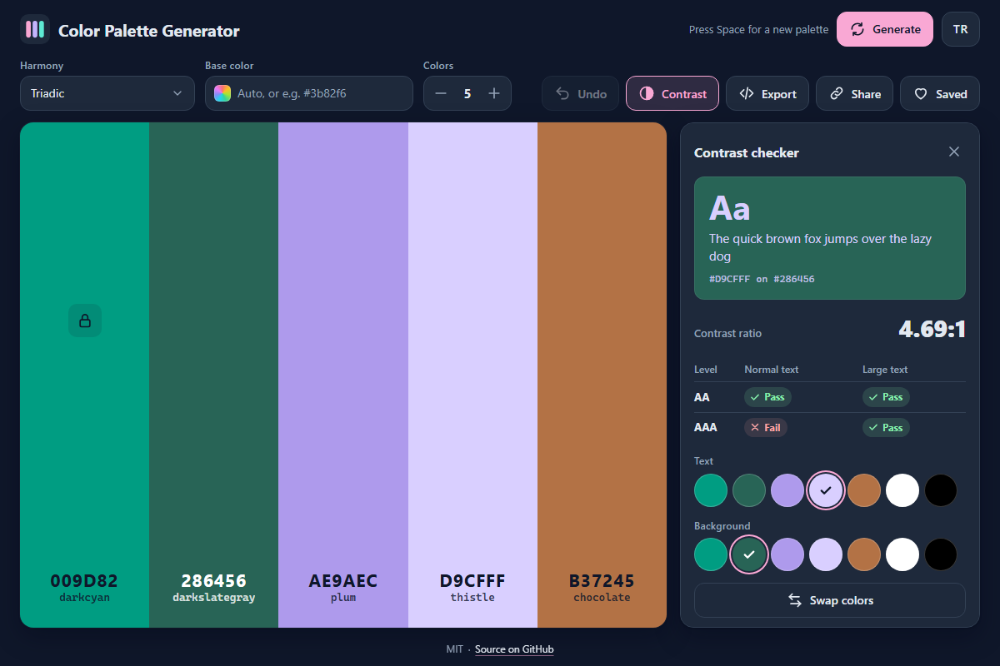

# Color Palette Generator - harmonious color palettes with contrast checks, shade scales and exports, right in the browser

[](#tests)
[](LICENSE)

**▶ Open the app: https://celaldrg.github.io/color-palette/**



No install and no build step: plain HTML, CSS and JavaScript modules.

## Features

- Full-height swatches (3 to 8 colors, 5 by default) with the HEX code and the nearest CSS color keyword, written in black or white, whichever reads better.
- Seven harmony modes computed in OKLCH: analogous, complementary, split complementary, triadic, tetradic, monochromatic and random harmonious, with an optional base color.
- Lock the colors you like and generate the rest again; drag swatches to reorder them; undo any step.
- Color editor with HSL or OKLCH sliders and a text field that takes HEX, RGB, HSL, HSV, OKLCH or a CSS color name; click any notation to copy it.
- Contrast checker: pick the text and background colors from the palette (or white and black) and see the WCAG 2.x ratio with AA and AAA results for normal and large text.
- Shade scale from 50 to 950 for any swatch; click a shade to copy it.
- Export as CSS custom properties, JSON or a Tailwind config (copied), or as an SVG strip (downloaded).
- Share links: the palette lives in the URL hash, so the address bar always holds the current palette.
- Saved palettes (up to 24) stay in your browser.
- English and Turkish interface, mobile-first layout, keyboard and touch controls, and it honours the reduced motion setting.
- Add `?demo` to the address for a fixed demo palette (the screenshot above).

Color names are the keyword of the nearest CSS named color (for example `darkcyan`), set in monospace like the HEX codes. They read the same in both languages and work as input in the color field and in CSS.

## How to use

### Keyboard

| Key | Action |
| --- | --- |
| Space | New palette (not while typing in a field) |
| Ctrl+Z / ⌘Z | Undo |
| Esc | Close the side panel or the export dialog |
| ← → ↑ ↓, Home, End on a swatch's drag handle | Move that swatch |
| Tab / Shift+Tab | Move between controls; Enter or Space presses them |

### Touch and mouse

- Tap **Generate** for a new palette.
- Tap a swatch to edit its color. The icons on a swatch lock it, show its shades, copy its HEX code and move it; press and drag a swatch (or its handle) to reorder.
- **Contrast**, **Export**, **Share** and **Saved** are in the toolbar (at the bottom on phones).
- **TR / EN** in the header switches the language; your choice is remembered.

## Run locally

Serve the folder with any static server, for example:

```sh
npx serve .
```

Then open the address it prints (such as http://localhost:3000). ES modules need `http://`: opening `index.html` straight from disk (`file://`) does not work.

## Tests

```sh
node --test
```

Node 20 or newer, no dependencies. GitHub Actions runs the tests on Node 22 for every push and pull request. They cover the logic modules in `src/`:

- color conversions (HEX, RGB, HSL, HSV, OKLab, OKLCH) round-tripping 1000 seeded colors, and gamut mapping;
- WCAG contrast ratios and AA/AAA results;
- harmony generation with a seeded random number generator, and the palette model (locks, reordering, edits, size, undo history);
- nearest color names, color parsing and formatting, slider math and shade scales;
- the CSS, JSON, Tailwind and SVG exports, share links, saved palettes and the storage wrapper;
- drag and keyboard reordering, keyboard shortcuts, the demo state, and that the English and Turkish strings match.

## Project structure

```
index.html              page markup, icons and meta tags
style.css               dark theme, mobile-first layout
src/
  main.js               entry point: connects the palette model to the page
  dom.js, *-view.js     UI: swatches, color editor, contrast, shades, saved palettes, export
  clipboard.js          copy and download helpers
  palette.js            palette model with locks and undo
  harmony.js            harmony modes in OKLCH
  color.js              color conversions and gamut mapping
  contrast.js           WCAG contrast
  names.js              nearest CSS color name
  notation.js           parse and format HEX, RGB, HSL, HSV and OKLCH
  shades.js sliders.js exporters.js share.js saved.js reorder.js shortcuts.js
  i18n.js               English and Turkish strings
  storage.js            localStorage wrapper
  rng.js demo.js        seeded random numbers and the ?demo state
test/                   node:test suites
docs/screenshot.png     screenshot of the ?demo state
```

## License

MIT, see [LICENSE](LICENSE).

## Türkçe

Tarayıcıda uyumlu renk paletleri üretir; kontrast denetimi, ton skalası ve dışa aktarma araçlarıyla birlikte. Kurulum ve derleme adımı yoktur: düz HTML, CSS ve JavaScript modülleri.

**▶ Uygulamayı aç: https://celaldrg.github.io/color-palette/**

### Özellikler

- Tam boy renk şeritleri (3 ile 8 arası renk, varsayılan 5): her birinde HEX kodu ve en yakın CSS renk anahtar sözcüğü, hangisi daha iyi okunuyorsa siyah ya da beyaz yazıyla.
- OKLCH'de hesaplanan yedi uyum modu: analog, tamamlayıcı, bölünmüş tamamlayıcı, üçlü, dörtlü, monokromatik ve rastgele uyumlu; isteğe bağlı ana renk.
- Beğendiğiniz renkleri kilitleyin, gerisini yeniden üretin; şeritleri sürükleyerek sıralayın; her adımı geri alın.
- Renk düzenleyici: HSL ya da OKLCH kaydırıcıları ve HEX, RGB, HSL, HSV, OKLCH ya da CSS renk adı kabul eden metin alanı; her gösterim tıklanınca kopyalanır.
- Kontrast denetimi: yazı ve arka plan rengini paletten (ya da beyaz ve siyahtan) seçin; WCAG 2.x oranını ve normal ile büyük yazı için AA ve AAA sonuçlarını görün.
- Her renk için 50'den 950'ye ton skalası; bir tona tıklayınca kopyalanır.
- Dışa aktarma: CSS değişkenleri, JSON ya da Tailwind yapılandırması (kopyalanır) veya SVG şerit (indirilir).
- Paylaşım bağlantısı: palet adresin # kısmında durur, adres çubuğu her zaman güncel paleti taşır.
- Kayıtlı paletler (en çok 24) tarayıcınızda saklanır.
- İngilizce ve Türkçe arayüz, önce mobil düzen, klavye ve dokunmatik kullanım, azaltılmış hareket ayarına uyum.
- Adrese `?demo` ekleyince sabit bir demo paleti açılır (yukarıdaki ekran görüntüsü).

Renk adları en yakın CSS adlandırılmış renginin anahtar sözcüğüdür (ör. `darkcyan`) ve HEX kodları gibi eş aralıklı yazıyla gösterilir. İki dilde de aynı okunur; renk alanına ve CSS'e olduğu gibi yazılabilir.

### Nasıl kullanılır

**Klavye**

| Tuş | İşlev |
| --- | --- |
| Boşluk | Yeni palet (bir alana yazarken değil) |
| Ctrl+Z / ⌘Z | Geri al |
| Esc | Yan paneli ya da dışa aktarma penceresini kapat |
| Şeridin sürükleme tutamacında ← → ↑ ↓, Home, End | O şeridi taşı |
| Tab / Shift+Tab | Denetimler arasında gez; Enter ya da Boşluk ile bas |

**Dokunmatik ve fare**

- Yeni palet için **Oluştur** düğmesine dokunun.
- Rengini düzenlemek için bir şeride dokunun. Şeritteki simgeler onu kilitler, tonlarını gösterir, HEX kodunu kopyalar ve taşır; sıralamak için şeridi (ya da tutamacını) basılı tutup sürükleyin.
- **Kontrast**, **Dışa aktar**, **Paylaş** ve **Kayıtlı** araç çubuğundadır (telefonda altta).
- Üstteki **TR / EN** düğmesi dili değiştirir; seçiminiz hatırlanır.

### Yerelde çalıştırma

Klasörü herhangi bir statik sunucuyla açın, örneğin:

```sh
npx serve .
```

Sonra yazdığı adresi açın (ör. http://localhost:3000). ES modülleri `http://` ister: `index.html` dosyasını doğrudan diskten (`file://`) açmak çalışmaz.

### Testler

```sh
node --test
```

Node 20 ya da daha yenisi yeter, bağımlılık yoktur. GitHub Actions testleri her push ve pull request'te Node 22 ile çalıştırır. Testler `src/` içindeki mantık modüllerini kapsar: renk dönüşümleri (1000 tohumlu renkte gidiş-dönüş) ve gamut eşleme; WCAG kontrast oranları ve AA/AAA sonuçları; tohumlu rastgele sayı üreteciyle uyum üretimi ve palet modeli (kilit, sıralama, düzenleme, boyut, geri alma geçmişi); renk adları, renk ayrıştırma ve biçimlendirme, kaydırıcı hesapları ve ton skalaları; CSS, JSON, Tailwind ve SVG dışa aktarımları, paylaşım bağlantıları, kayıtlı paletler ve depolama sarmalayıcısı; sürükleme ve klavyeyle sıralama, klavye kısayolları, demo durumu ve İngilizce ile Türkçe metinlerin eşleşmesi.

### Lisans

MIT, bkz. [LICENSE](LICENSE).
